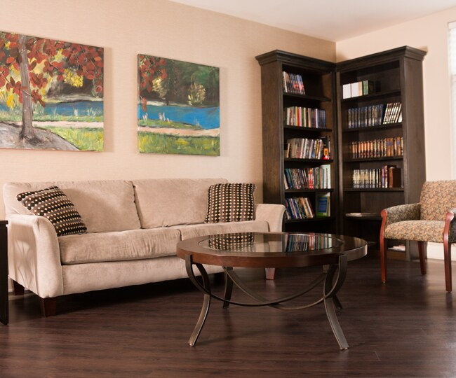

This is a sample story for checking the design. It isn’t from a real family. It
shows each kind of formatting a family’s story can use.

## A heading inside a story

A paragraph with **bold words**, _italic words_, and a
[link to Tikva House](/tikva-house).

### A smaller heading

- A bulleted list
- With a second item
- And a third

1. A numbered list
2. With a second item

> A quotation, set apart from the story around it. Families sometimes quote a
> letter, a doctor or a child.

A last paragraph after the photo.
